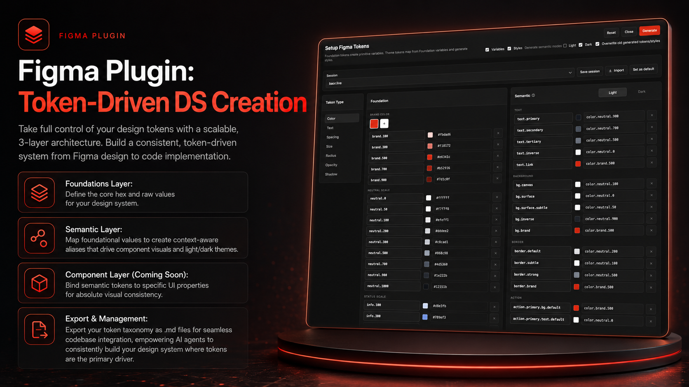

# Design Token Management

A Figma development plugin for turning Foundation primitives and semantic aliases into local Variables and Paint, Text, and Effect Styles.

## Why this exists

Maintaining token values, semantic roles, and styles by hand makes relationships difficult to inspect and repeat. This plugin puts Foundation and Semantic editors side by side so designers can define values, map their intent, and generate local assets in one workspace.

- Configure color, typography, spacing, size, radius, opacity, shadow, and motion tokens.
- Map independent Light/Dark semantic color aliases to Foundation values.
- Generate scoped Variables and semantic Styles; repeat generation updates existing assets.
- Save named sessions and defaults, restore the active session, and import/export setups.

## Try it

1. Download or clone this repository.
2. In Figma, choose `Plugins > Development > Import plugin from manifest...` and select `manifest.json`.
3. Open a disposable design file and run **Design Token Management**.
4. Review the defaults, choose Variables/Styles and Light/Dark options, then click **Generate**.
5. Inspect the generated assets and generate again to check updates.

Overwrite can prune obsolete assets previously tagged by this plugin. Test it in a disposable file before using a working design system.

[Example token JSON](examples/token-collections.json) contains Foundation colors and spacing with Theme aliases in two modes.

Token model

Foundation primitives use `color.*`, `space.*`, `size.*`, `radius.*`, `opacity.*`, `shadow.*`, `font.*`, `duration.*`, and `easing.*`. They live in the `Foundation` collection's `Value` mode and stay out of most property pickers.

Semantic roles live in `Theme`: for example, `color.bg.canvas`, `space.inset.sm`, `size.control.md`, `text.body.m`, and `motion.duration.enter`. Semantic variables alias Foundation primitives; semantic colors retain independent Light/Dark references. Only Theme tokens produce styles.

## Development

The plugin loads plain files directly from its manifest; no build step or runtime dependencies are required. Node.js 22+ runs development checks.

| File | Responsibility |
| --- | --- |
| [code.js](code.js) | Figma controller, token conversion, aliases, storage, and asset generation |
| [ui.html](ui.html) | Authoritative interface, styles, and inline JavaScript |
| [ui.js](ui.js) | Generated script mirror for review; not a separate runtime entry |
| [manifest.json](manifest.json) | Figma development entry points |

See [CONTRIBUTING.md](CONTRIBUTING.md) for setup and quality gates, [AGENTS.md](AGENTS.md) for agent constraints, [manual QA](docs/QA.md) for regression checks, and [UI guidelines](docs/UI.md) for visual foundations.

## Status and license

This is a locally installed development plugin. Automated tests simulate Figma APIs; live behavior, styles, fonts, persistence, and accessibility require manual verification. There is no claimed Community listing, completed accessibility audit, or measured user outcome.

**Personal, non-commercial use only.** See [LICENSE](LICENSE).
